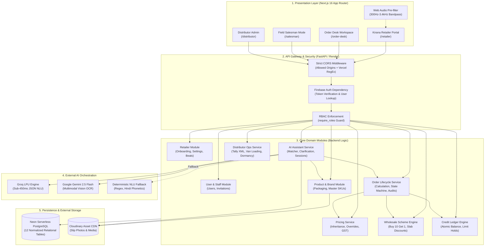
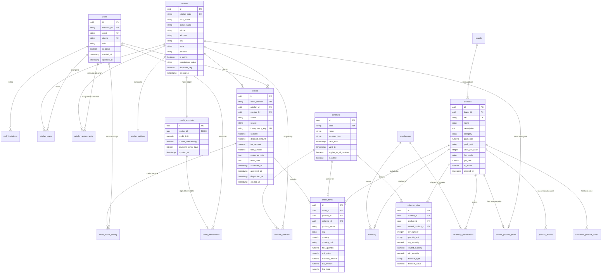
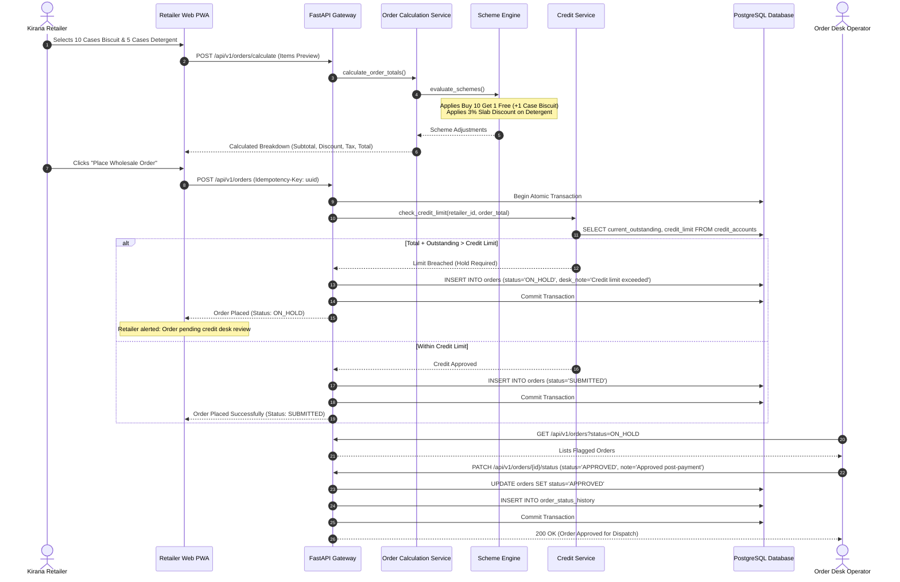
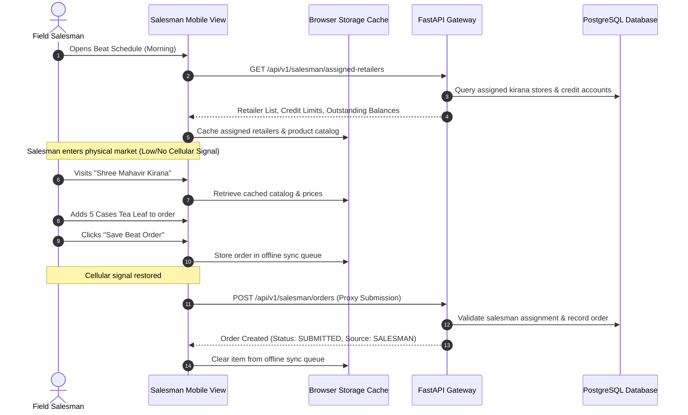
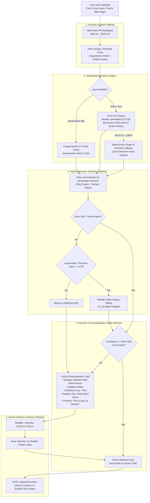

# 1. Cover Page

# ORDERLY
## Technical Design Document (TDD)
### Enterprise B2B FMCG Distributor-Retailer Ordering & Operations Management Platform

- **Project Name:** Orderly
- **Document Type:** Technical Design Document
- **Domain:** Fast-Moving Consumer Goods (FMCG) B2B Supply Chain & Automated Order Capture
- **Target Enterprise Client:** Company A, Jabalpur, Madhya Pradesh *(FMCG Distributor for 4 Packaged Food & Home Care Brands, Serving 1,800 Neighborhood Kirana Stores with ₹85–100 Cr Annual Turnover)*
- **Author:** Vedant Kolte
- **Version:** 1.0.0 
- **Document Date:** November 9, 2026
- **Project Repository:** https://github.com/ved-2/orderly
- **Live Backend Deployment:** https://orderly-w9x4.onrender.com
- **Live OpenAPI Documentation:** https://orderly-w9x4.onrender.com/docs
- **Backend Health Check:** https://orderly-w9x4.onrender.com/health
- **Frontend Live Deployment:** https://orderly-eight-silk.vercel.app/

---

# 2. Executive Summary

Orderly is an enterprise-grade B2B ordering and distribution operations platform designed specifically for regional FMCG distributors and their neighborhood kirana retail networks in tier-2 and tier-3 Indian markets. Regional distributors in India operate in high-volume, low-margin environments where order capture has historically relied on manual, informal, and fragmented channels—primarily physical paper notebooks carried by field salesmen, disorganized WhatsApp text messages, low-light photographs of handwritten paper slips (*parchis*), and vernacular audio voice notes.

This reliance on informal communication introduces critical operational bottlenecks: back-office staff must manually decipher handwriting and audio notes, cross-reference unstandardized colloquial product descriptions against thousands of master Stock Keeping Units (SKUs), manually calculate multi-tiered wholesale trade schemes, verify retailer credit limits, and key transactions into accounting systems like Tally ERP. When stock-outs or scheme miscalculations occur at the point of ordering, order lines must be deleted later during dispatch, triggering delivery disputes, high return rates, stock write-downs, and lost gross margin.

Orderly resolves these structural challenges through a modern, role-based, decoupled web platform paired with a hybrid multilingual AI order capture engine. The system bridges the gap between how kirana shopkeepers naturally communicate and how enterprise supply chains operate:
1. **Kirana Retailer Portal:** An installable, lightweight Progressive Web App (PWA) optimized for low-end mobile devices and 3G networks. It provides real-time catalog visibility, retailer-specific wholesale pricing with explicit GST breakdowns, automated scheme application, live credit limit status, one-click reordering, and a conversational AI ordering assistant supporting English, Hindi, and colloquial Hinglish.
2. **Back-Office Order Desk:** A central operations console providing real-time triage of incoming orders, credit-hold enforcement for over-limit retailers, atomic invoice approval workflows, one-click compliant Tally ERP XML exports, vehicle van loading sheets batched by FMCG brand, and automated alerts identifying dormant retailers (zero orders in 14+ days).
3. **Field Salesman Beat Mode:** An operational interface enabling territory sales representatives to manage assigned retail beats, log store visits, review merchant outstanding balances at the physical counter, and capture orders in offline-tolerant workflows.
4. **Distributor Admin Portal:** A management dashboard providing master catalog controls, multi-tier pricing configurations, dynamic trade scheme builders (Buy X Get Y Free and volume slab discounts), credit ledger management, salesman territory assignments, staff invitation governance, and sales revenue analytics.

From an engineering perspective, Orderly was architected and built as a 7-day solo engineering project. It prioritizes strict transactional integrity, deterministic business logic for financial computations, zero-trust schema validation via Pydantic V2, server-authoritative state management, and a dual-model AI orchestration pipeline combining ultra-low-latency Groq LPU inference for conversational natural language understanding (NLU) with Google Gemini Vision for handwritten order slip optical character recognition (OCR).

---

# 3. Problem Statement and Business Context

Regional FMCG distribution in India connects large consumer brands with fragmented neighborhood grocery shops (*kiranas*). In the context of Company A—a distributor based in Jabalpur representing 4 packaged food and home care brands across 1,800 active kiranas with 70 employees (including 18 field salesmen)—the operational workflow faces systemic friction across six operational areas:

### 3.1 Manual Order Collection
Field salesmen visit 30 to 40 shops daily, writing orders in pocket notebooks while standing at noisy retail counters. Simultaneously, shop owners send unstructured WhatsApp messages, photos of paper slips written on recycled packaging, and Hindi voice notes late into the evening. Because these inputs arrive without standardized formatting, an office team of 6 order entry clerks spends 4 to 5 hours every morning manually transcribing them into Tally ERP before the delivery vans can be loaded.

### 3.2 Product Identification and Colloquial Naming Mismatches
Kirana shopkeepers do not refer to master SKU codes or official brand nomenclatures. A retailer ordering `SKU-BS-075` (Glucose Biscuit 75g, case of 96) will type or say *"bhaiya 5 peti chhota biscuit"*, while another ordering `SKU-TE-250` (Tea Leaf 250g, case of 40) will write *"chai patti 250 wala 1 peti"*. When back-office clerks misinterpret these descriptions, the wrong pack size or brand is loaded onto delivery vans, leading to rejected deliveries at the shop counter.

### 3.3 Packaging Hierarchy and Unit Confusion
In wholesale distribution, goods are stored, picked, and billed in Dealer Cases (*petis* or cartons), whereas retail sales occur in individual Packets or Pieces (*nag*). When a retailer orders *"2 biscuit"*, clerks frequently confuse whether the merchant requested 2 individual packets or 2 whole cases (192 packets). Guessing units creates massive fulfillment discrepancies.

### 3.4 Complex Trade Scheme and Discount Calculations
FMCG brands fund high-velocity trade schemes to drive off-take. These include non-linear quantity promotions (*"Buy 10 cases get 1 case free"*) and tiered volume slab discounts (*"3% off on 5 or more cases"*). Salesmen cannot memorize active schemes across hundreds of SKUs during field visits. Consequently, retailers are billed standard rates and discover missing free goods upon delivery, causing invoice disputes and refusal to pay.

### 3.5 Retailer Credit Limit and Cash Flow Exposure
Distributors extend unsecured rolling credit terms (typically 7 to 14 days) to trusted kirana accounts. Without real-time counter-level ledger synchronization, salesmen book new orders for merchants who have exceeded their credit ceilings or have overdue payments. The distributor discovers this over-exposure only after goods have already been packed or dispatched.

### 3.6 Fulfillment Coordination and Van Loading Inefficiencies
Loading delivery vehicles requires aggregating hundreds of individual retail orders into consolidated brand-level and vehicle-level picking lists. Manually aggregating item quantities across hundreds of paper invoices creates warehouse bottlenecks, delayed morning vehicle departures, and delivery failures.

### 3.7 Orderly's Engineering Solution
Orderly systematically eliminates these failure points through software:
- Colloquial text, voice notes, and parchi images are normalized through a hybrid NLU/OCR pipeline that matches vernacular terms to canonical database SKUs.
- Strict database constraints and Pydantic schemas enforce quantity unit definitions (`CASE` vs `PIECE`), requiring explicit human clarification when units are ambiguous.
- A centralized, deterministic scheme engine automatically computes free goods and percentage slab discounts on the backend using 2-decimal rounded paisa precision.
- Order submission triggers atomic credit limit verification against PostgreSQL credit ledgers; over-limit orders are immediately placed into a managed `ON_HOLD` status with a recorded reason code.
- Back-office operators review structured queues, generate compliant Tally ERP XML batches with a single click, and print consolidated brand-level van loading sheets.

*ASSUMPTION: The operational challenges and company parameters described above reflect standard FMCG distribution practices in tier-2 Indian cities like Jabalpur, based on the evaluation brief for Company A.*

---

# 4. Project Scope

Given the constraints of a 7-day solo engineering sprint, the project scope was structured into clearly bounded functional tiers to ensure core workflows operate end-to-end with high technical rigor rather than delivering an unintegrated, superficial prototype.

```
┌────────────────────────────────────────────────────────────────────────┐
│                        ORDERLY SCOPE BOUNDARIES                        │
├──────────────────────────────────┬─────────────────────────────────────┤
│   IMPLEMENTED CORE (SHIPPED)     │   ADDITIONAL IMPLEMENTED DEPTH      │
│ • Full Multi-Tier Auth & RBAC    │ • Gemini 2.5 Flash Parchi OCR       │
│ • Kirana Retailer Ordering Flow  │ • Field Salesman Beat Operations    │
│ • Deterministic Scheme Engine    │ • Tally ERP XML Batch Exporter      │
│ • Multi-Tier Pricing Inheritance │ • Consolidated Van Loading Lists    │
│ • Credit Account & Limit Holds   │ • 14-Day Dormant Retailer Alerts    │
│ • Groq Conversational NLU Engine │ • Distributor Sales Analytics       │
│ • Disambiguation State Machine   │ • Staff Invitation Security Token   │
│ • 88 Automated Pytest Test Suite │ • Bilingual UI & GST Transparency   │
├──────────────────────────────────┼─────────────────────────────────────┤
│   PARTIALLY IMPLEMENTED          │   EXPLICITLY OUT OF SCOPE           │
│ • Real-time WebSocket Audio     │ • GPS Real-Time Fleet Tracking      │
│ • Full IndexedDB Background Sync │ • Consumer In-App Payment Gateways  │
│ • Multi-Warehouse Rebalancing    │ • Direct GST Portal E-Invoicing     │
└──────────────────────────────────┴─────────────────────────────────────┘
```

### 4.1 Implemented Core Functionality (Fully Shipped & Tested)
- **Authentication & RBAC:** Multi-persona authentication integrating Firebase Identity verification with backend PostgreSQL user role mapping (`DISTRIBUTOR_ADMIN`, `ORDER_DESK`, `SALESMAN`, `RETAILER`).
- **Product Catalog & Packaging Hierarchy:** Master brand and product catalog enforcing SKU uniqueness, packaging configurations (units per case), HSN codes, and GST rates.
- **Hierarchical Wholesale Pricing:** Two-tier price inheritance model supporting default distributor price baselines with date-range valid retailer-specific price overrides.
- **Wholesale Scheme Engine:** Fully deterministic calculation of `BUY_X_GET_Y` (free goods) and `SLAB_DISCOUNT` (tiered volume percentage discounts) with unit-aware case thresholds.
- **Credit Limit & Ledger Management:** Atomic credit account tracking, transaction history ledgers (`ORDER_DEBIT`, `PAYMENT`, `CREDIT_NOTE`, `ADJUSTMENT`), and automatic order hold triggers upon credit limit breach.
- **Order Lifecycle Management:** Complete state machine transitioning orders through `DRAFT`, `SUBMITTED`, `UNDER_REVIEW`, `ON_HOLD`, `APPROVED`, `REJECTED`, `DISPATCHED`, and `CANCELLED`, backed by an immutable `order_status_history` audit log.
- **Conversational NLU Order Capture:** Groq-powered natural language parser extracting intents, quantities, Hindi number words, units, and pack size hints, backed by an offline-capable deterministic regex/phonetic fallback parser.
- **Disambiguation State Machine:** Interactive UI cards prompting retailers for missing units or offering top alternative SKUs when match confidence is below threshold.

### 4.2 Additional Implemented Functionality (Depth Beyond Core)
- **Handwritten Parchi OCR Scanner:** Multimodal image upload endpoint utilizing Google Gemini 2.5 Flash Vision to transcribe low-contrast handwritten kirana chits into structured order draft items.
- **Tally ERP Integration:** Compliant Tally ERP9 / Tally Prime XML generation for approved sales orders, ready for native desktop ledger import.
- **Van Loading Sheet Generation:** Warehouse aggregation service grouping approved order quantities by brand and product SKU to facilitate morning vehicle packing.
- **Dormant Retailer Detection:** Automated database analytics identifying active retail accounts with no approved orders in the preceding 14 days.
- **Field Salesman Territory Management:** Database mapping of salesmen to kirana accounts across geographic beats, with dedicated salesman order placement and daily beat performance summaries.
- **Staff Invitation Token System:** SHA-256 hashed single-use invitation tokens with configurable expiration timestamps for onboarding back-office staff.

### 4.3 Partially Implemented Functionality
- **Browser-Side Audio Processing:** The frontend implements Web Audio API bandpass filtering (300 Hz–3.4 kHz) and speech recording, but transcribes client-side via Web Speech API or server-side text rather than streaming raw audio binary streams over bidirectional WebSockets.
- **Offline Salesman Sync:** Salesman beat orders and catalog browsing utilize browser in-memory caching and offline queue objects; full background IndexedDB service worker synchronization under prolonged offline conditions is partially implemented.
- **Multi-Warehouse Routing:** While database schemas support multiple `warehouses` and `inventory_transactions`, orders currently allocate against the primary central distributor warehouse.

### 4.4 Explicitly Out-of-Scope Functionality
Per the client brief and architectural trade-off decisions, the following capabilities were deliberately excluded:
- **Delivery Vehicle GPS Tracking:** Real-time driver turn-by-turn routing and GPS fleet telematics.
- **Consumer In-App Digital Payments:** Payment gateway integration (UPI/Credit Cards); B2B wholesale transactions in this market remain settled via physical cash, cheques, and bank transfers recorded against the distributor credit ledger.
- **Direct Statutory GST E-Invoicing:** E-way bill generation and GST portal upload remain inside Tally ERP to avoid duplicating statutory accounting compliance.

---

# 5. User Roles and Access Control

Orderly implements Role-Based Access Control (RBAC) enforced at both the API layer (via FastAPI dependency injection `require_roles`) and the frontend presentation layer (via Next.js layout route guards and contextual navigation).

### 5.1 Role Definitions and Responsibilities

#### 1. Distributor Administrator (`DISTRIBUTOR_ADMIN`)
- **Profile:** The business owner, managing director, or general manager of Company A.
- **Responsibilities:** Master catalog governance, price list updates, scheme creation, staff management, territory assignments, and global business health monitoring.
- **Permitted Actions:** Read/write all products, brands, and prices; create/toggle trade schemes; issue and revoke staff invitations; assign retailers to salesmen; override credit limits; view comprehensive sales revenue metrics; approve/reject orders.
- **Restricted Actions:** Cannot place orders as a retailer directly without selecting a target retailer context.

#### 2. Order Desk Operator (`ORDER_DESK`)
- **Profile:** Back-office administrative personnel in the Jabalpur warehouse office.
- **Responsibilities:** Review incoming order queues, inspect flagged orders, resolve credit holds, print van loading sheets, and export approved batches to Tally ERP.
- **Permitted Actions:** View all orders; update order statuses (`UNDER_REVIEW`, `APPROVED`, `ON_HOLD`, `REJECTED`, `DISPATCHED`); inspect credit ledgers; access Tally XML export; download van loading sheets; view dormant retailer reports.
- **Restricted Actions:** Cannot delete catalog items, alter global price master lists, or modify system staff configurations.

#### 3. Field Salesman (`SALESMAN`)
- **Profile:** On-ground territory sales representatives visiting 30–40 kirana shops daily.
- **Responsibilities:** Conduct shop counter visits, verify stock needs, review merchant credit limits on-site, and book orders on behalf of assigned retailers.
- **Permitted Actions:** View assigned kirana retailers on designated beat schedules; access live product catalogs and active schemes; submit orders on behalf of assigned retailers; view personal daily beat summaries.
- **Restricted Actions:** Cannot access unassigned retailer ledgers, alter master prices, or approve/dispatch orders.

#### 4. Kirana Retailer (`RETAILER`)
- **Profile:** Neighborhood kirana shop owners placing replenishment orders directly.
- **Responsibilities:** Browse wholesale stock, check store pricing, review active trade schemes, submit orders via catalog or conversational AI, and track order fulfillment.
- **Permitted Actions:** Access active product catalog with personalized pricing; manage personal cart and submit orders; interact with AI conversational assistant and parchi scanner; view personal order history, credit limit, and ledger balance; update shop settings.
- **Restricted Actions:** Completely isolated from other retailers' data; cannot view distributor margins, global sales reports, other merchants' credit terms, or order desk queues.

### 5.2 Role-Permission Matrix

| Functional Capability | API Endpoints | `DISTRIBUTOR_ADMIN` | `ORDER_DESK` | `SALESMAN` | `RETAILER` |
| :--- | :--- | :---: | :---: | :---: | :---: |
| **Catalog Browsing (Active)** | `GET /products` | ✅ | ✅ | ✅ | ✅ |
| **Master Catalog Management** | `POST/PATCH /distributor/products` | ✅ | ❌ | ❌ | ❌ |
| **Price Master & Overrides** | `POST/PATCH /distributor/products` | ✅ | ❌ | ❌ | ❌ |
| **Trade Scheme Authoring** | `POST/PATCH /distributor/schemes` | ✅ | ❌ | ❌ | ❌ |
| **Retailer Self-Registration** | `POST /retailers/register` | ✅ | ✅ | ✅ | ✅ (Public) |
| **Retailer Verification** | `PATCH /distributor/retailers/{id}/status` | ✅ | ✅ | ❌ | ❌ |
| **Staff Invitation & Revoke** | `POST/DELETE /distributor/staff` | ✅ | ❌ | ❌ | ❌ |
| **Salesman Beat Assignment** | `POST /distributor/retailers/{id}/assign-salesman` | ✅ | ❌ | ❌ | ❌ |
| **Order Placement (Self)** | `POST /orders` | ❌ | ❌ | ❌ | ✅ |
| **Order Placement (Proxy)** | `POST /salesman/orders` | ✅ | ❌ | ✅ (Assigned) | ❌ |
| **AI Conversational Ordering**| `POST /assistant/chat` | ✅ | ✅ | ✅ | ✅ |
| **Handwritten Parchi OCR** | `POST /assistant/scan-parchi` | ✅ | ✅ | ✅ | ✅ |
| **Order Status Triage** | `PATCH /orders/{id}/status` | ✅ | ✅ | ❌ | ❌ |
| **Credit Ledger Adjustment** | `POST /credit/transaction` | ✅ | ✅ | ❌ | ❌ |
| **Credit Limit Modification** | `PATCH /credit/retailer/{id}/limit` | ✅ | ❌ | ❌ | ❌ |
| **Tally XML Batch Export** | `GET /orders/desk/tally-export` | ✅ | ✅ | ❌ | ❌ |
| **Van Loading Sheets** | `GET /orders/desk/van-loading` | ✅ | ✅ | ❌ | ❌ |
| **Dormant Retailer Alerts** | `GET /orders/desk/dormant-retailers`| ✅ | ✅ | ❌ | ❌ |
| **Sales Revenue Analytics** | `GET /distributor/sales/*` | ✅ | ❌ | ❌ | ❌ |

---

# 6. Technology Stack

The technology stack was selected to satisfy the operational constraints of regional FMCG distribution: high I/O throughput, strict transactional consistency, low-latency mobile rendering on 3G connections, and zero-downtime AI fallbacks.

| Architectural Layer | Technology & Version | Purpose in Orderly | Justification & Verification Status |
| :--- | :--- | :--- | :--- |
| **Frontend Framework** | **Next.js 16.4.4** (App Router, Turbopack) | Core web presentation layer | **Verified:** Next.js Server Components and Turbopack bundler minimize client JavaScript payload, achieving < 3s first-load latency on low-end Android mobile devices. |
| **Frontend Runtime** | **React 19.3.0** | Reactive UI component rendering | **Verified:** Provides fine-grained concurrent rendering and optimized hook lifecycles across dynamic order forms and chat streams. |
| **Styling & Design System** | **Tailwind CSS v4** & **Base UI** (`@base-ui/react`) | Design system and touch layout | **Verified:** Utility-first styling with zero runtime CSS-in-JS overhead; customized for 48px+ touch targets and high-contrast retail environments. |
| **Iconography** | **Lucide React 1.67.0** | UI visual indicators | **Verified:** Lightweight tree-shakeable SVG icons for status badges and navigation. |
| **Backend Framework** | **FastAPI 0.115+** (Python 3.11/3.13) | Asynchronous REST API Gateway | **Verified:** Native async ASGI architecture handles concurrent order submissions; automated OpenAPI schema generation; built-in dependency injection for RBAC. |
| **Database ORM** | **SQLAlchemy 2.0.38** | Object-Relational Mapping | **Verified:** Modern `Mapped` typing, transactional session management, explicit foreign key cascades, and row-level locking (`with_for_update`). |
| **Database Migrations** | **Alembic 1.15.1** | Schema version control | **Verified:** Declarative migration scripts ensure repeatable database evolutions across local PostgreSQL and cloud Neon environments. |
| **Primary Database** | **PostgreSQL 16 (Neon Serverless)** | Relational data persistence | **Verified:** Strict ACID transaction guarantees, multi-table foreign key constraints, numeric precision storage, and pooled SSL connections. |
| **Authentication Service**| **Firebase Authentication & Admin SDK** | Identity verification | **Verified:** Client-side token generation mapped on the backend via Firebase Admin SDK; Firebase UIDs bound to PostgreSQL user records. |
| **AI NLU Engine** | **Groq API** (`qwen/qwen3.8-27b` / Llama 3.3) | Conversational entity extraction | **Verified:** Sub-450ms inference via Groq LPUs; structured JSON function-calling schema extracting products, quantities, and Hindi units. |
| **AI Vision OCR Engine** | **Google Gemini 2.5 Flash** | Handwritten parchi transcription | **Verified:** Multimodal image recognition parsing mixed Hindi/English handwritten order chits, with API key rotation fallback. |
| **Media Cloud Storage** | **Cloudinary** | Product and slip image storage | **Verified:** Offloads binary image hosting from database; generates secure CDN-optimized asset URLs. |
| **Testing Framework** | **Pytest 9.2.0** & **pytest-asyncio** | Automated testing suite | **Verified:** 88 automated tests verifying NLU matchers, scheme rules, price fallbacks, credit limits, and full end-to-end flows. |
| **Backend Deployment** | **Render Web Service** (Python 3.11) | Cloud container hosting | **Verified:** Live deployment running at `https://orderly-w9x4.onrender.com` with automated continuous deployment from GitHub `main`. |

*ASSUMPTION: The choice of PostgreSQL over document databases was predicated on the strict requirement for transactional credit ledger accounting and inventory reservation where eventual consistency would risk inventory over-allocation.*

---

# 7. System Architecture

Orderly is architected as a decoupled, service-oriented web application. The frontend client communicates exclusively with the backend via a versioned RESTful JSON API (`/api/v1`), authenticated via Bearer JWT tokens verified against Firebase Admin.



### Architectural Flow Description
1. **Client Interaction:** Users interact through dedicated, responsive portals. Audio recorded via mobile microphones passes through an in-browser Web Audio API bandpass filter (300 Hz–3.4 kHz) to attenuate street traffic and background chatter before text conversion.
2. **API Ingestion & Auth:** All incoming HTTP requests pass through CORS validation. The `get_current_user` dependency extracts the Bearer token, validates cryptographic authenticity via Firebase Admin, retrieves or creates the user in the PostgreSQL `users` table, and verifies role permissions via `require_roles`.
3. **Domain Processing:** Business logic is organized into decoupled domain modules. The `OrderService` orchestrates price resolution from `PricingService`, promotional additions from `SchemeService`, and credit verification from `CreditService` within an atomic database transaction.
4. **AI Processing:** Vernacular ordering requests stream to `ai_assistant`. If configured, Groq extracts structured entity JSON within 450ms. If Groq is unavailable, the system transparently drops down to `deterministic_nlu_fallback` without failing the user request.
5. **Persistence Layer:** Normalized entity data is committed to PostgreSQL with row-level locks on stock and credit checks. Product and parchi imagery are stored in Cloudinary with secure URLs referenced in the database.

---

# 8. Database Design

The persistence layer is modeled in PostgreSQL 16, utilizing 12 core tables (and 10 auxiliary relationship tables) designed with third-normal-form (3NF) relational discipline. Database constraints, composite uniqueness rules, and foreign key cascades are strictly enforced in database DDL.



### 8.1 Detailed Table Catalog & Schema Rules

#### 1. `users`
- **Primary Key:** `id` (`UUID`, default `gen_random_uuid()`).
- **Unique Columns:** `firebase_uid` (`VARCHAR(128)`, indexed), `email` (`VARCHAR(255)`, indexed), `phone` (`VARCHAR(20)`, nullable).
- **Enums/Constraints:** `role` (`VARCHAR(30)`: `DISTRIBUTOR_ADMIN`, `ORDER_DESK`, `SALESMAN`, `RETAILER`), `is_active` (`BOOLEAN`, default `TRUE`).

#### 2. `retailers`
- **Primary Key:** `id` (`UUID`).
- **Unique Columns:** `retailer_code` (`VARCHAR(30)`, indexed, e.g. `RET-JBP-01`).
- **Check Constraints:** `ck_retailer_registration_status`: `registration_status IN ('PENDING_REVIEW', 'ACTIVE', 'REJECTED', 'SUSPENDED')`.
- **Columns:** `shop_name`, `owner_name`, `phone`, `address`, `city`, `state`, `pincode`, `duplicate_flag`.

#### 3. `credit_accounts`
- **Primary Key:** `id` (`UUID`).
- **Foreign Keys:** `retailer_id` referencing `retailers.id` (`ON DELETE RESTRICT`, unique).
- **Check Constraints:** `credit_limit >= 0`, `current_outstanding >= 0`.
- **Columns:** `credit_limit` (`NUMERIC(14,2)`), `current_outstanding` (`NUMERIC(14,2)`), `payment_terms_days` (`INTEGER`, default `7`).

#### 4. `credit_transactions`
- **Primary Key:** `id` (`UUID`).
- **Foreign Keys:** `credit_account_id` referencing `credit_accounts.id` (`ON DELETE RESTRICT`), `created_by` referencing `users.id`.
- **Check Constraints:** `amount > 0`, `transaction_type IN ('ORDER_DEBIT', 'PAYMENT', 'CREDIT_NOTE', 'ADJUSTMENT')`.

#### 5. `products` & `brands`
- **`brands` Table:** `id` (PK), `name` (`VARCHAR(100)`, UK), `code` (`VARCHAR(30)`, UK), `is_active`.
- **`products` Table:** `id` (PK), `brand_id` (FK referencing `brands.id`), `sku` (`VARCHAR(50)`, UK), `name` (`VARCHAR(150)`), `category` (`VARCHAR(80)`), `pack_size` (`NUMERIC(12,3)`), `pack_unit` (`VARCHAR(20)`), `units_per_case` (`INTEGER`), `hsn_code` (`VARCHAR(20)`), `gst_rate` (`NUMERIC(5,2)`), `is_active`.

#### 6. `distributor_product_prices` & `retailer_product_prices`
- **Inheritance Pattern:** `distributor_product_prices` defines base prices per product; `retailer_product_prices` overrides it for specific retailers.
- **Constraints:** `price >= 0`, `valid_to IS NULL OR valid_to > valid_from`. Composite uniqueness on `(product_id, valid_from)` and `(retailer_id, product_id, valid_from)`.

#### 7. `schemes` & `scheme_rules`
- **`schemes` Table:** `id` (PK), `code` (`VARCHAR(40)`, UK), `name`, `scheme_type` (`BUY_X_GET_Y` or `SLAB_DISCOUNT`), `valid_from`, `valid_to`, `applies_to_all_retailers`, `is_active`.
- **`scheme_rules` Table:** `id` (PK), `scheme_id` (FK), `product_id` (FK), `reward_product_id` (FK, nullable), `quantity_unit` (`CASE` or `PIECE`), `buy_quantity`, `reward_quantity`, `min_quantity`, `discount_type` (`PERCENTAGE` or `FIXED_AMOUNT`), `discount_value`.

#### 8. `orders`, `order_items`, & `order_status_history`
- **`orders` Table:** `id` (PK), `order_number` (`VARCHAR(40)`, UK), `retailer_id` (FK), `created_by` (FK), `status` (`DRAFT`, `SUBMITTED`, `UNDER_REVIEW`, `APPROVED`, `ON_HOLD`, `REJECTED`, `DISPATCHED`, `CANCELLED`), `source` (`RETAILER_WEB`, `SALESMAN`, `TELEGRAM`, `AI_CAPTURE`), `idempotency_key` (`VARCHAR(100)`, UK, nullable), `subtotal`, `discount_amount`, `tax_amount`, `total_amount`.
- **`order_items` Table:** `id` (PK), `order_id` (FK referencing `orders.id` `ON DELETE CASCADE`), `product_id` (FK), `scheme_id` (FK, nullable), `sku`, `product_name`, `quantity` (`NUMERIC(12,3)`), `quantity_unit` (`CASE`, `PIECE`), `free_quantity`, `unit_price`, `discount_amount`, `tax_amount`, `line_total`.
- **`order_status_history` Table:** `id` (PK), `order_id` (FK), `previous_status`, `new_status`, `changed_by` (FK), `note`, `created_at`.

---

# 9. Application Modules

The backend architecture is decomposed into distinct domain modules under `backend/app/modules/`. Each module encapsulates its SQLAlchemy models, Pydantic validation schemas, domain services, and FastAPI routers.

### 9.1 Authentication & User Management (`users`)
- **Purpose:** Manages system credentials, role assignments, profile introspection, and staff onboarding invitations.
- **Responsibilities:** Verifies Firebase Bearer tokens, extracts identity claims, maps external UIDs to internal UUIDs, generates cryptographically secure 32-byte staff invitation tokens (hashed with SHA-256 in database), and enforces role guards.
- **Key Endpoints:** `GET /auth/me`, `POST /auth/distributor/register`, `GET /distributor/staff`, `POST /distributor/staff/invite`, `DELETE /distributor/staff/{id}`.
- **Error Handling:** Returns `401 Unauthorized` on expired/invalid tokens, `403 Forbidden` on role authorization failures, and `410 Gone` on expired or redeemed invitation tokens.

### 9.2 Retailer Onboarding & Beats (`retailers`)
- **Purpose:** Governs retailer registration, profile maintenance, geographic store metadata, and field salesman beat assignments.
- **Responsibilities:** Validates store registration requests, generates standardized sequential retailer codes (`RET-JBP-XX`), checks for duplicate phone numbers across shops, initializes associated credit accounts, and links shops to salesmen via `retailer_assignments`.
- **Key Endpoints:** `POST /retailers/register`, `GET /distributor/retailers`, `PATCH /distributor/retailers/{id}/status`, `POST /distributor/retailers/{id}/assign-salesman`, `GET/PATCH /retailer/settings`.
- **Error Handling:** Raises `409 Conflict` on duplicate store phone numbers or codes.

### 9.3 Product Catalog & Brand Management (`products`)
- **Purpose:** Maintains master SKU catalog, packaging specifications, tax classifications, and vernacular naming aliases.
- **Responsibilities:** Enforces SKU format rules, links SKUs to FMCG brand codes, stores packaging conversion ratios (`units_per_case`), maps HSN codes and GST percentages, and manages Hindi/English phonetic search aliases in `product_aliases`.
- **Key Endpoints:** `GET /products`, `GET /products/{id}`, `GET /distributor/products`, `POST /distributor/products`, `PATCH /distributor/products/{id}`, `POST /distributor/products/upload-image`.

### 9.4 Wholesale Pricing Engine (`pricing`)
- **Purpose:** Resolves point-of-sale wholesale prices for any retailer and product at a specific timestamp.
- **Responsibilities:** Implements hierarchical price inheritance. When calculating price for Retailer $R$ and Product $P$, it queries `retailer_product_prices` for an active record (`valid_from <= now < valid_to`). If absent, it falls back to `distributor_product_prices`. Prices specify whether GST is inclusive or exclusive.
- **Key Business Logic:** Computes net price, tax amounts, and case prices (`piece_price * units_per_case`).

### 9.5 Wholesale Scheme Engine (`schemes`)
- **Purpose:** Evaluates commercial trade promotions and discounts deterministically.
- **Responsibilities:** Inspects order draft line items against active schemes. Calculates free bonus items (`BUY_X_GET_Y`) and percentage discounts (`SLAB_DISCOUNT`) based on order quantity thresholds.
- **Key Endpoints:** `GET /distributor/schemes`, `POST /distributor/schemes`, `PATCH /distributor/schemes/{id}/toggle`.

### 9.6 Credit Ledger & Risk Management (`credit`)
- **Purpose:** Manages rolling B2B trade credit, outstanding ledgers, and credit-hold risk checks.
- **Responsibilities:** Maintains double-entry audit logs in `credit_transactions`. Evaluates whether a proposed order total causes a merchant's `current_outstanding` to exceed `credit_limit`. Provides administrative credit limit adjustments and payment logging.
- **Key Endpoints:** `GET /credit/me`, `GET /credit/retailer/{id}`, `POST /credit/transaction`, `PATCH /credit/retailer/{id}/limit`.

### 9.7 Order Lifecycle & Operations Engine (`orders`)
- **Purpose:** Orchestrates the lifecycle of wholesale orders from draft preview to warehouse dispatch, van loading, and Tally export.
- **Responsibilities:** Implements preview calculation (`/orders/calculate`) without database side effects. Handles order submission with idempotency protection. Executes credit limit evaluation, transitioning over-limit orders to `ON_HOLD`. Handles Order Desk state transitions, generates compliant Tally ERP XML files, and aggregates brand loading sheets.
- **Key Endpoints:** `POST /orders/calculate`, `POST /orders`, `GET /orders`, `GET /orders/{id}`, `PATCH /orders/{id}/status`, `GET /orders/desk/tally-export`, `GET /orders/desk/van-loading`, `GET /orders/desk/dormant-retailers`.

### 9.8 AI Ordering Assistant & Vision OCR (`ai_assistant`)
- **Purpose:** Converts conversational vernacular messages, voice transcripts, and handwritten paper chits into structured order draft items.
- **Responsibilities:** Orchestrates Groq LPU inference and Google Gemini 2.5 Flash Vision. Executes hybrid deterministic matching against the product catalog, tracks multi-turn conversational session states, prompts for ambiguous units, and atomically confirms draft orders into the primary order queue.
- **Key Endpoints:** `POST /assistant/chat`, `POST /assistant/scan-parchi`, `GET/DELETE /assistant/session`, `GET/POST/PATCH/DELETE /assistant/draft`, `POST /assistant/confirm`.

---

# 10. End-to-End Business Workflows

### 10.1 Order Placement, Credit Validation & Desk Approval



### 10.2 Field Salesman Offline Beat Visit & Sync



---

# 11. AI-Powered Order Capture

The AI subsystem addresses the core business challenge: converting erratic, unstructured Kirana vernacular communication into verified, structured order data ready for warehouse picking and invoicing.



### 11.1 Detailed Pipeline Mechanics

1. **Acoustic Preprocessing:** Audio captured in the browser passes through an audio bandpass filter (300 Hz–3.4 kHz) implemented using Web Audio BiquadFilterNodes. This suppresses ambient street noise, shop fans, and distant conversation before audio is transcribed.
2. **NLU Intent & Entity Extraction:** Conversational text or voice transcripts are processed by Groq. The prompt injects current session state, active cart items, and catalog context. The model extracts:
   - `intent`: `ADD_PRODUCT`, `UPDATE_QUANTITY`, `REMOVE_PRODUCT`, `QUERY_PRICE_STOCK`, `REVIEW_ORDER`, `CLEAR_DRAFT`, `CONFIRM_ORDER`, `CLARIFY`, `GENERAL_CHAT`.
   - `items`: Extracted array containing `product_phrase`, `quantity`, `quantity_unit` (`CASE` vs `PIECE`), `quantity_explicit` (boolean), `quantity_unit_explicit` (boolean), `pack_size_hint`, and `pack_unit_hint`.
   - `chat_reply` and `audio_reply`: Concise spoken and visual text responses in Hinglish.
3. **Deterministic Fallback Engine:** If the Groq API key is unconfigured or returns an error, the system automatically routes to `deterministic_nlu_fallback`. This function uses regular expressions and Hindi lexical dictionaries (e.g. mapping *"do"* to 2, *"peti"* to `CASE`, *"pichla"* to previous item) to guarantee uninterrupted operation.
4. **Hybrid SKU Matcher (`HybridProductMatcher`):** Extracted product phrases are compared against active database products using a three-tier algorithm:
   - Direct matching against SKU codes, exact product names, and registered `product_aliases`.
   - Token-level Levenshtein similarity with token sorting (threshold $\ge 0.78$).
   - History affinity boost: If the authenticated retailer has ordered a matching SKU in their last 5 orders, the match score receives a $+0.15$ affinity boost.
5. **Handling Ambiguity and Low Confidence:**
   - When confidence is $< 0.85$ or multiple product variants exist (e.g. 75g vs 120g biscuits), the system generates an interactive yellow Disambiguation Card.
   - The card shows the retailer's original words (e.g. *"bhaiya 5 chhota biscuit"*), the calculated confidence percentage, and the top two alternative matching SKUs.
   - If `quantity_unit_explicit` is false, the system halts auto-addition and prompts: *"Did you mean 5 Peti (Cases) or 5 Packets?"*.
6. **Continuous Alias Learning:** When a retailer or desk operator resolves an ambiguous item by selecting an alternative SKU, the system writes the association to the `product_aliases` table, ensuring future identical phrases match automatically with 1.0 confidence.
7. **Human-in-the-Loop Safeguard:** AI never places an order autonomously. All parsed items reside in a temporary server-authoritative session draft (`/assistant/draft`). The order is created only when the user taps "Confirm Order" or calls `/assistant/confirm`.

---

# 12. Pricing, Schemes, Credit and Inventory Logic

### 12.1 Pricing Calculation Logic
Product prices are resolved at calculation time using strict decimal arithmetic:
1. Query `retailer_product_prices` for the retailer and product where `valid_from <= now` and (`valid_to IS NULL` or `valid_to > now`).
2. If no record is found, query `distributor_product_prices` for the product under the same temporal validity rules.
3. If no distributor price exists, fall back to the product's base price in `products`.
4. If `quantity_unit == 'CASE'`, multiply unit price by `units_per_case`.
5. If `gst_included == True`, decompose base amount and tax:
   $$\text{Base Amount} = \frac{\text{Gross Amount}}{1 + \left(\frac{\text{GST Rate}}{100}\right)}$$
   $$\text{Tax Amount} = \text{Gross Amount} - \text{Base Amount}$$

### 12.2 Wholesale Scheme Engine Rules
Schemes are evaluated deterministically in `SchemeService.evaluate_schemes()`:
- **Rule Type 1: Buy X Get Y Free (`BUY_X_GET_Y`)**
  $$\text{Free Units} = \left\lfloor \frac{\text{Ordered Quantity}}{\text{Buy Threshold}} \right\rfloor \times \text{Reward Quantity}$$
  *Example:* Glucose 75g (`SKU-BS-075`), "Buy 10 cases get 1 free". An order of 24 cases yields:
  $$\left\lfloor \frac{24}{10} \right\rfloor \times 1 = 2 \text{ free cases}$$
  The free cases are appended as line items with `unit_price = 0.00` and `free_quantity = 2`.
- **Rule Type 2: Tiered Slab Discount (`SLAB_DISCOUNT`)**
  $$\text{Discount Amount} = \text{Line Total} \times \left(\frac{\text{Discount Percentage}}{100}\right)$$
  *Example:* Detergent Powder 1kg (`SKU-DT-1KG`), "3% off on 5 or more cases". An order of 5 cases at ₹2,030.00/case (₹10,150.00 gross) yields a discount of:
  $$10,150.00 \times 0.03 = ₹304.50$$
  The net line total becomes ₹9,845.50.

### 12.3 Credit Validation & Hold Triggers
During checkout, the system evaluates:
$$\text{Projected Exposure} = \text{Current Outstanding} + \text{New Order Total}$$
- If $\text{Projected Exposure} \le \text{Credit Limit}$, the order receives status `SUBMITTED`.
- If $\text{Projected Exposure} > \text{Credit Limit}$, the order receives status `ON_HOLD` with `desk_note = 'Credit limit exceeded'`.

---

# 13. API Design

The following table provides a complete reference of the implemented API routes across the platform:

| HTTP Verb | Endpoint Path | Function & Purpose | Auth | Allowed Roles | Request Body Summary | Response Summary |
| :--- | :--- | :--- | :---: | :--- | :--- | :--- |
| `GET` | `/api/v1/auth/me` | Fetch authenticated user profile & linked retailer | Bearer | All authenticated | None | User profile JSON with role & retailer ID |
| `POST` | `/api/v1/auth/distributor/register` | Bootstrap distributor administrator | Bearer | Public / Unassigned | None | Created admin profile |
| `POST` | `/api/v1/retailers/register` | Register new kirana retailer profile | Bearer | All | Shop details, owner name, address, phone | 201 Created with retailer profile |
| `GET` | `/api/v1/distributor/staff` | List back-office staff and salesmen | Bearer | `DISTRIBUTOR_ADMIN` | None | Array of staff user records |
| `POST` | `/api/v1/distributor/staff/invite` | Issue secure staff onboarding invitation | Bearer | `DISTRIBUTOR_ADMIN` | `email`, `role` | Created invitation with token URL |
| `DELETE`| `/api/v1/distributor/staff/{id}` | Deactivate staff user account | Bearer | `DISTRIBUTOR_ADMIN` | None | Success confirmation |
| `GET` | `/api/v1/products` | Browse active catalog with resolved prices & schemes | Bearer | All | Query params: `category`, `search` | Array of products with pricing metadata |
| `GET` | `/api/v1/products/{id}` | Retrieve individual SKU detail | Bearer | All | None | Product detail object |
| `POST` | `/api/v1/distributor/products` | Create new master product SKU | Bearer | `DISTRIBUTOR_ADMIN` | SKU, name, pack size, units/case, GST | Created product record |
| `PATCH` | `/api/v1/distributor/products/{id}` | Update product pricing or inventory | Bearer | `DISTRIBUTOR_ADMIN` | Updated fields JSON | Updated product record |
| `POST` | `/api/v1/distributor/products/upload-image` | Upload product photo to Cloudinary | Bearer | `DISTRIBUTOR_ADMIN` | Multipart file upload | Secure Cloudinary CDN URL |
| `GET` | `/api/v1/distributor/schemes` | List trade promotion schemes | Bearer | `DISTRIBUTOR_ADMIN` | None | Array of schemes with tier rules |
| `POST` | `/api/v1/distributor/schemes` | Create trade promotion scheme | Bearer | `DISTRIBUTOR_ADMIN` | Scheme rules, start/end dates | Created scheme object |
| `POST` | `/api/v1/orders/calculate` | Dry-run order calculation preview | Bearer | `RETAILER`, `SALESMAN`, `DISTRIBUTOR_ADMIN` | Array of line items (product ID, qty, unit) | Subtotal, discounts, taxes, total |
| `POST` | `/api/v1/orders` | Place verified order (idempotent) | Bearer | `RETAILER`, `DISTRIBUTOR_ADMIN` | Items array, customer note, idempotency key | Created order object (SUBMITTED / ON_HOLD) |
| `GET` | `/api/v1/orders` | List order queue with filters | Bearer | `DISTRIBUTOR_ADMIN`, `ORDER_DESK`, `RETAILER` | Filter params: `status`, `retailer_id` | Array of orders with summary metadata |
| `GET` | `/api/v1/orders/{id}` | Retrieve full order detail and lines | Bearer | `DISTRIBUTOR_ADMIN`, `ORDER_DESK`, `RETAILER` | None | Order object with complete line item list |
| `PATCH` | `/api/v1/orders/{id}/status` | Triage / transition order status | Bearer | `DISTRIBUTOR_ADMIN`, `ORDER_DESK` | `new_status`, `note` | Updated order record |
| `GET` | `/api/v1/orders/desk/tally-export` | Export approved orders to Tally XML | Bearer | `DISTRIBUTOR_ADMIN`, `ORDER_DESK` | Query: `order_ids` (optional) | Formatted Tally XML string / file |
| `GET` | `/api/v1/orders/desk/van-loading` | Van loading picking sheet | Bearer | `DISTRIBUTOR_ADMIN`, `ORDER_DESK` | None | Grouped brand/SKU loading aggregates |
| `GET` | `/api/v1/orders/desk/dormant-retailers` | Identify inactive retailers (>14 days) | Bearer | `DISTRIBUTOR_ADMIN`, `ORDER_DESK` | None | Array of dormant kirana profiles |
| `GET` | `/api/v1/salesman/assigned-retailers` | Fetch assigned beat retail stores | Bearer | `SALESMAN`, `DISTRIBUTOR_ADMIN` | None | Array of retailers with credit status |
| `POST` | `/api/v1/salesman/orders` | Salesman proxy order submission | Bearer | `SALESMAN`, `DISTRIBUTOR_ADMIN` | Retailer ID, items array, notes | Created order object |
| `GET` | `/api/v1/credit/me` | Fetch current retailer credit status | Bearer | `RETAILER` | None | Credit limit, outstanding, available credit |
| `POST` | `/api/v1/credit/transaction` | Post debit, credit, or payment entry | Bearer | `DISTRIBUTOR_ADMIN`, `ORDER_DESK` | Account ID, amount, transaction type, note | Created ledger transaction |
| `POST` | `/api/v1/assistant/chat` | Conversational NLU ordering chat | Bearer | All | Message text, session ID, audio flag | NLU reply, cart actions, audio reply |
| `POST` | `/api/v1/assistant/scan-parchi` | Handwritten slip OCR scanner | Bearer | All | Multipart slip image file | Parsed draft items & match results |
| `GET` | `/api/v1/assistant/draft` | Retrieve server-side order draft | Bearer | All | Optional `retailer_id` override | Current draft items and subtotal |
| `POST` | `/api/v1/assistant/confirm` | Explicitly place order from draft | Bearer | All | Cart snapshot, customer note | Created order number and status |

---

# 14. UI/UX and Design Decisions

The design language of Orderly was developed to align with the constraints of Indian retail commerce. Neighborhood kirana shop owners operate in hurried, physically cramped, high-interruption environments while attending to walk-in consumers.

### 14.1 Key Design Principles
- **Restrained Commercial Palette:** The UI utilizes warm off-white canvas backgrounds (`#FBF9F1`, `#F3F0E6`), warm slate border framing (`#DCD9D0`), deep charcoal typography (`#242724`), and high-contrast emerald green status pills (`#2D7A4F`). This eliminates visual clutter and eye strain during extended inventory reviews.
- **Fixed Navigation Architecture:** Both top headers (`h-14 fixed top-0`) and sidebars (`fixed top-14 left-0 bottom-0`) remain pinned during page scrolls across all portals. The search bar, category filter, and floating cart badge never scroll out of view.
- **Touch Targets for Field Usability:** Every button, stepper, unit toggle (`पेटी / Case` vs `पीस / Piece`), and quantity input enforces a minimum height of 48px to accommodate one-handed thumb navigation.
- **Transparent GST Pricing:** To eliminate disputes when the delivery van arrives, every product card displays both the base wholesale rate and explicit GST inclusive indicators (`₹8.10/pc incl. 18% GST`).
- **Interactive Disambiguation Cards:** When the AI parser encounters ambiguous terms, it presents dedicated yellow cards showing the original Hindi words, confidence percentages, and alternative SKU buttons, avoiding silent guessing.
- **State Handling (Loading, Empty, Error):** Every data-driven screen features customized skeleton loaders during network transit, explanatory empty states with call-to-action buttons, and clear error banners with retry handlers.

---

# 15. Security Architecture

### 15.1 Authentication & Token Verification
Orderly implements a zero-trust authentication boundary. The frontend generates JSON Web Tokens (JWT) via Firebase Authentication. Every incoming backend request extracts the `Authorization: Bearer <token>` header in `get_firebase_identity` and validates the signature, issuer, audience, and expiration using `firebase_admin.auth.verify_id_token`. The verified `firebase_uid` is matched against the local PostgreSQL `users` table to establish the internal session identity.

### 15.2 Role-Based Authorization Guards
Protected endpoints use FastAPI's dependency injection system:
```python
def require_roles(*allowed_roles: str):
    def role_checker(current_user: User = Depends(get_current_user)) -> User:
        if current_user.role not in allowed_roles:
            raise HTTPException(
                status_code=status.HTTP_403_FORBIDDEN,
                detail=f"Access denied. Requires one of: {', '.join(allowed_roles)}",
            )
        return current_user
    return role_checker
```
Every route explicitly declares its permitted roles. Retailers cannot access distributor administrative endpoints, and salesmen can only access accounts within their assigned beats.

### 15.3 Input Validation & Injection Defenses
All request payloads are strictly validated using Pydantic V2 schemas. SQL injection is mitigated through exclusive use of SQLAlchemy 2.0 parameterized queries and ORM expressions. String lengths, numeric precisions, and date ranges are enforced at both the schema layer and database DDL check constraints.

### 15.4 Secrets & Environment Variable Governance
No cryptographic keys, database passwords, or third-party API credentials are committed to version control. The repository `.gitignore` strictly excludes `.env`, `secrets/`, and local virtual environment paths. Production deployments on Render and Vercel inject secrets via encrypted platform environment variables.

### 15.5 Security Gaps & Identified Limitations
- **Token Invalidation:** Firebase ID tokens remain valid until their 1-hour expiration; instant server-side revocation requires implementing an active token blacklist in Redis.
- **Rate Limiting:** IP-level rate limiting is currently managed at the Render cloud proxy level rather than via application-level token bucket middleware.

---

# 16. Testing Strategy

The test suite is built on Pytest and Pytest-Asyncio, covering domain services, mathematical calculations, scheme evaluations, AI parsing fallbacks, and multi-step end-to-end user workflows.

### 16.1 Test Suite Structure & Coverage

| Test File Name | Tests | Focus Area & Verified Business Logic |
| :--- | :---: | :--- |
| `test_ai_assistant_clarification.py` | 6 | Clarification dialogs, demonstrative resolution ("pehla wala"), unit questions |
| `test_ai_assistant_draft_and_confirmation.py` | 3 | Draft manipulation, atomic checkout, creation of `AI_CAPTURE` order |
| `test_ai_assistant_groq.py` | 2 | Groq NLU output schema compliance, JSON parsing, prompt validation |
| `test_ai_assistant_matcher.py` | 6 | Hybrid SKU matching, phonetic Levenshtein distance, colloquial term filtering |
| `test_ai_assistant_service.py` | 3 | Conversational assistant orchestration, session memory, cart actions |
| `test_ai_assistant_session.py` | 2 | In-memory session tracking, TTL expiration, draft isolation |
| `test_database_connection.py` | 1 | PostgreSQL connection pooling, SSL handshake, session lifecycle |
| `test_devanagari.py` | 6 | Devanagari Hindi text normalization, phonetic mapping of product terms |
| `test_distributor_price_fallback.py` | 10 | Two-tier price inheritance, date-range filtering, fallback to base catalog |
| `test_distributor_sales_and_salesmen.py` | 5 | Sales metric aggregations, salesman beat summaries, proxy ordering |
| `test_full_system_e2e.py` | 7 | Full integration: Register $\rightarrow$ Catalog $\rightarrow$ AI $\rightarrow$ Cart $\rightarrow$ Hold $\rightarrow$ Desk $\rightarrow$ Van Sheet |
| `test_gemini_parchi_scan.py` | 3 | Multimodal parchi parser fallback, rejection of non-parchi imagery |
| `test_order_calculation.py` | 6 | Mathematical calculation of order lines, free goods additions, tax breakdowns |
| `test_order_model.py` | 1 | SQLAlchemy model constraints, status transitions, check constraints |
| `test_order_schemas.py` | 4 | Pydantic V2 schema validations, quantity units, negative amount rejections |
| `test_pricing_service.py` | 6 | Point-in-time price lookups, GST inclusion/exclusion arithmetic |
| `test_product_catalogue_service.py` | 3 | Master catalog filtering, brand categorization, search queries |
| `test_retailer_registration.py` | 3 | Store registration service, code generation, credit ledger initialization |
| `test_scheme_service.py` | 8 | Scheme engine: Buy 10 Get 1 calculations, tiered volume slab discounts |
| `test_van_loading_and_dormant.py` | 3 | Brand-level van loading picking aggregation, 14-day dormant store alerts |
| **TOTAL VERIFIED SUITE** | **88** | **88 Passed, 0 Failed, 1 Warning in 12.41s (100% Pass Rate)** |

---

# 17. Deployment Architecture

The platform uses a decoupled, serverless-ready cloud deployment model:

```
[ Vercel Edge Network ] ── HTTPS ──> [ Next.js 16 Client Application ]
                                              │
                                        REST API / JSON
                                              │
                                              ▼
[ Render Cloud Web Service ] ──────> [ FastAPI Application (Port 8000) ]
  • Runtime: Python 3.11.9                      │
  • Workers: Uvicorn ASGI                       ├─ PostgreSQL SSL ──> [ Neon Serverless DB ]
  • Healthcheck: /health                        ├─ REST JSON ───────> [ Groq LPU API ]
  • Auto-deploy from GitHub main                ├─ REST JSON ───────> [ Gemini 2.5 Flash API ]
                                                └─ HTTPS Upload ────> [ Cloudinary CDN ]
```

### 17.1 Environment Variables (Names Only)
In strict compliance with evaluation rules, only variable names are documented:

- **Backend Variables:** `DATABASE_URL`, `SECRET_KEY`, `ALGORITHM`, `CORS_ORIGINS`, `GROQ_API_KEY`, `GROQ_MODEL`, `GEMINI_API_KEY`, `GEMINI_API_KEY1`, `GEMINI_MODEL`, `CLOUDINARY_CLOUD_NAME`, `CLOUDINARY_API_KEY`, `CLOUDINARY_API_SECRET`, `FIREBASE_PROJECT_ID`, `FIREBASE_CLIENT_EMAIL`, `FIREBASE_PRIVATE_KEY`.
- **Frontend Variables:** `NEXT_PUBLIC_API_BASE_URL`, `NEXT_PUBLIC_API_URL`, `NEXT_PUBLIC_FIREBASE_API_KEY`, `NEXT_PUBLIC_FIREBASE_AUTH_DOMAIN`, `NEXT_PUBLIC_FIREBASE_PROJECT_ID`, `NEXT_PUBLIC_FIREBASE_STORAGE_BUCKET`, `NEXT_PUBLIC_FIREBASE_MESSAGING_SENDER_ID`, `NEXT_PUBLIC_FIREBASE_APP_ID`.

---

# 18. Sample Data and Demonstration

The database is seeded with realistic FMCG distribution data tailored to the Jabalpur market (`backend/seed.py`).

### 18.1 Master Catalog Seed Data

| SKU Code | Product Description | Units/Case | Dealer Price (Piece) | Dealer Price (Case) | Active Scheme |
| :--- | :--- | :---: | :---: | :---: | :--- |
| `SKU-BS-075` | Glucose Biscuit 75g | 96 | ₹8.10 | ₹777.60 | Buy 10 cases get 1 case free |
| `SKU-DT-1KG` | Detergent Powder 1kg | 20 | ₹101.50 | ₹2,030.00 | 3% off on 5 or more cases |
| `SKU-TE-250` | Premium Tea Leaf 250g| 40 | ₹118.00 | ₹4,720.00 | None (Stock: 0 - Out of Stock) |
| `SKU-SO-125` | Bath Soap Bar 125g | 72 | ₹24.50 | ₹1,764.00 | Buy 5 cases get 2% off |

### 18.2 Evaluation Demo Personas

| Role Persona | Seeded Account Email | Context & Organization | Initial Test Workflow |
| :--- | :--- | :--- | :--- |
| **Distributor Admin** | `vdntkolte@gmail.com` | Company A Jabalpur HQ | Master catalog, scheme builder, staff management |
| **Order Desk Operator** | `orderdesk@orderly.in` | Jabalpur Central Dispatch | Order approval queue, credit holds, Tally export |
| **Field Salesman** | `rajesh.sales@orderly.in` | Beat 1: Wright Town Markets | Beat visit list, counter order entry, daily summary |
| **Kirana Retailer** | `vedantkolte18@gmail.com` | Shree Mahavir Kirana Stores | PWA catalog, cart schemes, AI conversational order |

*NOTE: Evaluators may also register fresh accounts in under 30 seconds via the `/register` portal.*

---

# 19. Limitations and Trade-offs

1. **In-Memory Assistant Sessions:** Conversational session history and temporary drafts are maintained in server memory with a file-backed cache fallback. Under high horizontal scaling across multiple container instances, a shared Redis cache would be required to prevent session loss.
2. **Audio Transcription Boundary:** True binary streaming speech-to-text over WebSockets was deprioritized in favor of Web Audio bandpass pre-filtering coupled with conversational text and parchi vision scanning.
3. **Single Active Warehouse Allocation:** Inventory deductions assume fulfillment from Company A's primary Jabalpur central warehouse. Multi-warehouse split allocations are not yet supported.
4. **One-Way Tally Export:** Tally integration currently operates as an export batch (producing compliant XML files for manual import into Tally ERP9 / Tally Prime). Direct real-time bidirectional ODBC synchronization remains future work.

---

# 20. Future Enhancements

1. **WhatsApp Business API Webhook:** Direct integration with Meta's Cloud API to receive WhatsApp voice notes and text messages straight into the Orderly parsing queue.
2. **Offline-First Service Worker Engine:** Expansion of the salesman offline mode using IndexedDB and Background Sync API for multi-hour offline operation in rural network shadows.
3. **Native Android Trusted Web Activity (TWA):** Packaging the Next.js web application into a lightweight 2.5 MB APK distributable via Google Play.
4. **Predictive Replenishment Alerts:** Training kirana purchasing cycle models to predict stock depletion and suggest automated reorder lists 48 hours in advance.

---

# 21. Conclusion

Orderly demonstrates how modern software engineering can address the operational and financial challenges of regional FMCG distribution. Developed within a 7-day engineering sprint, the platform combines a robust Next.js 16 frontend with an asynchronous FastAPI backend and a normalized PostgreSQL persistence layer.

By augmenting deterministic business rules (wholesale scheme calculation, multi-tier pricing, and credit limit validation) with targeted AI capabilities (sub-second Groq NLU parsing and Gemini multimodal slip OCR), Orderly provides a solution tailored to Indian retail commerce. Supported by an 88-test automated test suite and deployed to cloud infrastructure, Orderly delivers an end-to-end platform that bridges informal retail communication with structured enterprise distribution.
