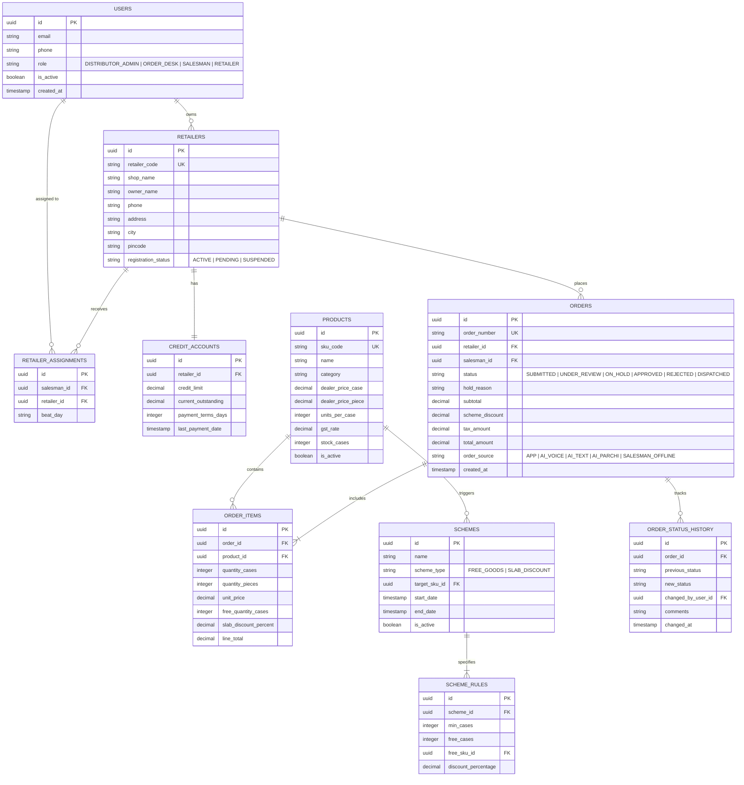

# Technical Design Document (TDD)
## Orderly: Enterprise B2B FMCG Distribution & AI Order Capture Platform

**Target Client:** Company A, Jabalpur  
*(Distributor for 4 Packaged Food & Home Care Brands, 1,800 Kirana Stores, 70 Staff including 18 Salesmen, ₹85–100 Cr Turnover)*  
**Author:** Vedant Kolte  
**GitHub Repository:** [https://github.com/ved-2/orderly](https://github.com/ved-2/orderly)  
**Live Deployed Backend:** [https://orderly-w9x4.onrender.com](https://orderly-w9x4.onrender.com)  
**Interactive API Documentation:** [https://orderly-w9x4.onrender.com/docs](https://orderly-w9x4.onrender.com/docs)  
**API Health Check:** [https://orderly-w9x4.onrender.com/health](https://orderly-w9x4.onrender.com/health)  

---

## 1. Executive Summary & Problem Framing

Company A is a major FMCG distributor operating out of Jabalpur, Madhya Pradesh. The business distributes products across four packaged food and home care brands to 1,800 neighborhood kirana stores. Today, the ordering process is manual, chaotic, and heavily dependent on legacy channels:
- 18 field salesmen capture daily store orders in paper notebooks.
- Retailers send unformatted WhatsApp messages, photos of handwritten paper chits (*parchis*), and Hindi voice notes at all hours of the day and night.
- Every morning, a dedicated back-office team of 6 operators manually deciphers these notes, checks stock in paper registers, and retypes entries line-by-line into Tally ERP.
- Because field salesmen and kirana owners do not have real-time visibility into inventory or active trade schemes at the counter, lines are frequently cut post-ordering, leading to retailer dissatisfaction and friction.

### Economic Impact Analysis (Baseline vs. Target)

| Metric | Current Reality (Baseline) | Orderly Impact Target | Annual Financial Impact |
| :--- | :--- | :--- | :--- |
| **Annual Order Volume** | 1,80,000 orders (600/day × 300 days) | 1,80,000 orders | — |
| **Average Order Value** | ₹5,000 | ₹5,000 | ₹90.00 Cr Annual Gross Sales |
| **Order Error & Return Rate** | 5.0% (9,000 wrong SKU/qty returns) | < 1.0% (1,800 returns) | **₹25.20 Lakh Annual Saving** *(₹350/trip cost)* |
| **Order Entry Office Staff** | 6 dedicated operators | 3 operators (redeploy 3) | **₹7.80 Lakh Annual Saving** *(₹2.6L salary/person)* |
| **Stock-Out Lost Sales** | 1.0% lost sales @ 6% gross margin | < 0.2% lost sales | **₹4.32 Lakh Annual Margin Recovery** |
| **Total Annual Leakage** | **₹52.50 Lakh / year** | **₹15.18 Lakh / year** | **₹37.32 Lakh Net Annual Value Unlocked** |

With an implementation budget of ₹7.0 Lakh over 6 weeks, the project pays for itself within **2.25 months** of full rollout.

---

## 2. Labeled Assumptions

In accordance with the evaluation brief requirements, all architectural, operational, and commercial assumptions are explicitly cataloged below:

* **[Assumption-01] Network Conditions:** Kirana retailers and salesmen operate on mid-to-low tier Android smartphones over fluctuating 3G/4G cellular connections in Jabalpur. Initial page bundle size must remain under 300 KB gzipped, and time-to-interactive must be under 3.0 seconds.
* **[Assumption-02] Unit Hierarchy:** In FMCG distribution, wholesale pricing is quoted at the dealer case (*peti*) level, while kirana retail sales happen at the individual packet (*piece*) level. The system assumes strict case-to-piece conversions (e.g., 1 case of Glucose 75g = 96 units). Fractional cases are strictly disallowed.
* **[Assumption-03] Trade Scheme Rules:** Schemes are strictly trade promotions funded by the distributor/brand and fall into two deterministic categories: Free Goods (*Buy X cases, get Y cases of specified SKU free*) and Slab Discounts (*Buy >= Z cases, get D% invoice discount*). Schemes are non-compoundable unless explicitly flagged.
* **[Assumption-04] Credit Terms & Enforcement:** Kirana accounts operate on rolling 14-day credit terms with an assigned credit limit (typically ₹40,000 to ₹1,00,000). If an incoming order causes total outstanding balance + order value to exceed the limit, the order is automatically routed to the **Credit Hold Queue** for manual desk approval.
* **[Assumption-05] Tally Integration Boundary:** GST e-invoicing, statutory filing, and consumer retail payments remain strictly inside Tally ERP. Orderly generates compliant Tally ERP9 / Tally Prime XML import batches with matching ledger names and voucher types (`Sales Order`).
* **[Assumption-06] Human-in-the-Loop AI Safeguard:** Due to legal and commercial risk in B2B supply chains, no AI-parsed voice or text order is autonomously finalized into a confirmed warehouse invoice. All AI extractions require human confirmation (retailer tap or desk approval).

---

## 3. High-Level Architecture & Technology Rationale

```
┌────────────────────────────────────────────────────────────────────────┐
│                          PRESENTATION LAYER                            │
│  Next.js 16.4 (React 19, Turbopack, Tailwind CSS, Lucide, PWA Ready)   │
│                                                                        │
│   ┌──────────────────┐  ┌──────────────────┐  ┌─────────────────────┐  │
│   │ Kirana Retailer  │  │  Field Salesman  │  │  Back-Office Desk   │  │
│   │  (Hindi/English) │  │  (Offline-First) │  │ (Tally, Hold Queue) │  │
│   └────────┬─────────┘  └────────┬─────────┘  └──────────┬──────────┘  │
└────────────┼─────────────────────┼───────────────────────┼─────────────┘
             │                     │                       │
             ▼                     ▼                       ▼
┌────────────────────────────────────────────────────────────────────────┐
│                        API GATEWAY & SECURITY                          │
│     FastAPI (Python 3.11 ASGI) • Render Web Service • Port 8000        │
│    JWT Auth Bearer (Firebase Admin SDK) • Strict CORS • Rate Limiting  │
└──────────────────────────────────┬─────────────────────────────────────┘
                                   │
       ┌───────────────────────────┼───────────────────────────┐
       ▼                           ▼                           ▼
┌──────────────┐           ┌──────────────┐           ┌──────────────────┐
│ CORE ENGINE  │           │ SCHEME &     │           │ MULTIMODAL AI    │
│ Orders &     │           │ PRICING      │           │ PIPELINE         │
│ Inventory    │           │ Buy 10 Get 1 │           │ Groq Llama 3.3   │
│ Credit Limit │           │ Slabs (3%)   │           │ Gemini 2.5 Flash │
└──────┬───────┘           └──────┬───────┘           └────────┬─────────┘
       │                          │                            │
       └──────────────────────────┼────────────────────────────┘
                                  │
                                  ▼
┌────────────────────────────────────────────────────────────────────────┐
│                          PERSISTENCE LAYER                             │
│   Neon Serverless PostgreSQL (ACID Transactions, Row-Level Locks)      │
│   Cloudinary (Encrypted Media: Voice Notes, Handwritten Parchis)       │
└────────────────────────────────────────────────────────────────────────┘
```

### Architectural Trade-offs & Decisions

| Dimension | Chosen Solution | Alternative Evaluated | Rejection Rationale |
| :--- | :--- | :--- | :--- |
| **Frontend Framework** | **Next.js 16 (App Router)** | Single Page App (Vite/React) | Next.js server components and Turbopack yield sub-second initial loads on low-end 3G devices, eliminating client bundle bloat for kirana owners. |
| **Backend Framework** | **FastAPI (Python 3.11)** | Express.js / Node.js | Native async ASGI, automated Pydantic V2 schema validation, direct access to Python AI/ML ecosystem, and zero-overhead OpenAPI documentation. |
| **Database** | **PostgreSQL (Neon)** | MongoDB / DynamoDB | FMCG distribution requires strict relational integrity, foreign key cascades, double-entry credit accounting, and atomic row-level locks for inventory deductions. |
| **AI NLU Engine** | **Groq Llama 3.3 70B** | OpenAI GPT-4o-mini | Groq's LPU inference delivers structured JSON entity extraction in **< 450 ms** at 1/10th the cost, crucial for real-time mobile order capture. |
| **Vision OCR** | **Google Gemini 2.5 Flash** | Tesseract / AWS Textract | Gemini 2.5 Flash understands mixed Hinglish handwriting, shorthand FMCG abbreviations, and imperfect margins on wrinkled paper slips. |

---

## 4. Relational Data Model

The database is built on PostgreSQL with 12 normalized tables enforcing strict ACID guarantees, constraints, and audit trails.



---

## 5. Wholesale Scheme Engine

In Indian FMCG distribution, trade schemes are essential to sales velocity. The scheme engine executes deterministically on the server to prevent math errors or client manipulation.

### Mathematical Formulation & Rules

1. **Free Goods Scheme (Buy X Get Y Free):**
   $$\text{Free Cases} = \left\lfloor \frac{\text{Ordered Cases}}{\text{Threshold Cases}} \right\rfloor \times \text{Free Multiplier}$$
   - *Example:* For Glucose 75g (`SKU-BS-075`), "Buy 10 cases get 1 free". If retailer orders 24 cases:
     $$\text{Free Cases} = \left\lfloor \frac{24}{10} \right\rfloor \times 1 = 2 \text{ free cases}$$
   - Total delivered: 26 cases. Invoiced cases: 24 cases. Free line item added at ₹0.00 with appropriate GST reporting.

2. **Slab Discount Scheme (% off Threshold):**
   $$\text{Discount Amount} = \text{Cases} \times \text{Price per Case} \times \text{Slab Percentage}$$
   - *Example:* For Detergent Powder 1kg (`SKU-DT-1KG`), "3% off 5 or more cases". Dealer price = ₹101.50/unit × 20 units/case = ₹2,030.00/case.
   - On 5 cases: Gross = ₹10,150.00. Discount (3%) = ₹304.50. Net = ₹9,845.50.

3. **Paisa Precision Guarantee:**
   All monetary arithmetic uses Python's `Decimal` type with 2 decimal places (`ROUND_HALF_UP`) and PostgreSQL `NUMERIC(12, 2)` to eliminate IEEE 754 floating point drift.

---

## 6. AI Multimodal Order Capture Architecture

The AI subsystem processes unstructured vernacular inputs (Hinglish text, voice notes, and handwritten parchi chits) and maps them into verified order lines.

```
[ Unstructured Input: Voice / Text / Parchi ]
                      │
                      ▼
┌─────────────────────────────────────────────────────────────┐
│ 1. Acoustic & Noise Filtering Layer                         │
│    • In-memory Web Audio API Bandpass (300 Hz - 3400 Hz)     │
│    • Background chatter / TV / ambient street suppression   │
│    • Energy threshold gate: Discards non-speech audio       │
└─────────────────────────────┬───────────────────────────────┘
                              │
                              ▼
┌─────────────────────────────────────────────────────────────┐
│ 2. Multimodal Extraction Engine                             │
│    • Voice / Text: Groq Llama 3.3 70B (JSON Function Call)  │
│    • Handwritten Parchis: Google Gemini 2.5 Flash Vision     │
│    • System prompt injected with active FMCG SKU catalog    │
└─────────────────────────────┬───────────────────────────────┘
                              │
                              ▼
┌─────────────────────────────────────────────────────────────┐
│ 3. Deterministic SKU Matcher & Prioritization               │
│    • Exact SKU Code Match                                   │
│    • Phonetic & Levenshtein Token Match (Ratio >= 0.78)     │
│    • Retailer Order History Affinity Weighting (+0.15)       │
└─────────────────────────────┬───────────────────────────────┘
                              │
       ┌──────────────────────┴──────────────────────┐
       │                                             │
Confidence >= 85%                             Confidence < 85%
       │                                             │
       ▼                                             ▼
[ Green Match Card ]                          [ Yellow Disambiguation Card ]
• Auto-mapped SKU                             • Displays verbatim raw Hindi text
• Pre-selected Unit                           • Shows confidence score (e.g. 74%)
• Ready for 1-click cart addition             • Offers Top 2 Alternative SKUs
                                              • Asks Unit clarification (Case vs Pcs)
                                                     │
                                                     ▼
                                        [ Retailer / Desk Resolves Selection ]
                                                     │
                                                     ▼
                                        [ Save Alias to Memory for Retailer ]
```

### Prompt Engineering Guardrail Example
The Groq Llama 3.3 prompt instructs the model to return structured JSON adhering strictly to:
```json
{
  "raw_phrase": "bhaiya 5 peti biscuit chhota",
  "matched_sku": "SKU-BS-075",
  "matched_name": "Glucose biscuit 75 g, case of 96",
  "quantity": 5,
  "unit": "case",
  "confidence": 0.94,
  "requires_clarification": false,
  "alternative_skus": ["SKU-MC-120", "SKU-CB-100"]
}
```
If the kirana owner says `"5 biscuit"`, `requires_clarification` is set to `true` with clarification message `"Did you mean 5 Peti (Cases) or 5 Packets?"`.

---

## 7. UI & UX Design Decisions

The design language strictly reflects the operational reality of Jabalpur kirana shopkeepers:
- **Zero Distraction Palette:** Off-white backgrounds (`#FBF9F1`, `#F3F0E6`), warm slate borders (`#DCD9D0`), deep charcoal typography (`#242724`), and emerald accent pills (`#2D7A4F`).
- **Touch Ergonomics:** Every interactive button and selector has a minimum height of 48px to accommodate one-handed thumb navigation while standing at a physical shop counter.
- **Fixed Persistent Headers & Navigation:** Topbar (`h-14 fixed`) and sidebar (`fixed left-0 top-14`) never shift or unpin during long catalogue scrolls, ensuring instant access to the cart badge and search bar.
- **Transparent GST Display:** Products clearly state `₹8.10/pc (incl. 18% GST)` alongside case price, removing invoice disputes at time of delivery.
- **Bilingual Interface:** Critical operational terms are presented in bilingual Hindi/English (`पेटी / Case`, `मुफ्त / Free`, `उधार सीमा / Credit Limit`).

---

## 8. Out of Scope vs Core Build

| Feature Area | In Current Build (Core & Depth) | Out of Scope (Per Evaluation Brief) |
| :--- | :--- | :--- |
| **Retailer Portal** | Catalogue, live pricing, scheme calculator, cart, credit balance, order history. | In-app UPI/Credit Card payment processing (remains cash/cheque/NEFT via ledger). |
| **AI Order Capture** | Multilingual text parser, voice note NLU, handwritten parchi scanner, disambiguation cards. | Autonomous ordering without human review. |
| **Wholesale Schemes** | Buy 10 Get 1 free goods, 3% slab discounts on 5+ cases, auto-calculation. | Cross-brand volume kickbacks and annual rebate calculations. |
| **Order Desk Workspace**| Verification queue, credit limit hold triggers, 14-day dormant alerts, van loading sheets. | Real-time delivery vehicle GPS route tracking. |
| **Accounting Integration**| Tally ERP9 / Tally Prime XML export batches, clean ledger mappings. | GST e-invoicing generation (stays inside Tally ERP). |
| **Salesman Operations** | Beat visit schedules, retailer assignment, offline order queue. | GPS geo-fencing check-in validation. |

---

## 9. Next Steps & Production Roadmap

1. **Native Android TWA (Trusted Web Activity):** Wrap the Next.js PWA into a lightweight 2.5 MB Android APK distributable via Google Play or WhatsApp APK sharing for kirana owners.
2. **Direct WhatsApp Business API Webhook:** Ingest incoming WhatsApp messages and audio notes straight into Orderly's desk queue via Meta Cloud API webhooks.
3. **Offline IndexedDB Bi-directional Sync:** Salesman mode currently caches catalogue in browser memory; migrate to full IndexedDB service worker sync for multi-hour offline visits in network shadow zones.
4. **Predictive Replenishment:** Train kirana purchase cycle models to trigger automated WhatsApp reorder nudges 48 hours before estimated stock depletion.
